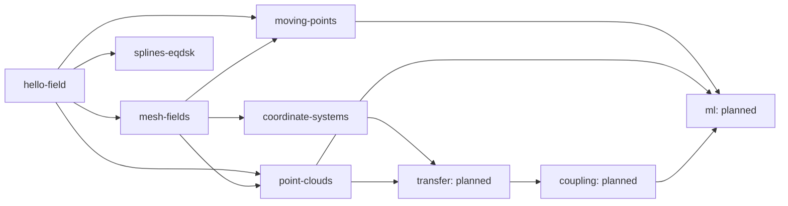

# PCMS examples

Programs that show how to use PCMS, one idea at a time, in the way deal.II's
tutorial steps do: every example is a short program with its explanation in
comments between the blocks of code, a README with a summary, the APIs it uses
and what to look at, a C++ version and a Python version that tell the same
story, and a test that runs it in seconds on generated data and checks its own
result. Read one next to its source; the sources are the documentation.

The examples use the public API only (see [Rules](#rules)), so what they do is
what your code can do.

## Tracks

| track | directory | what it is about | status |
|---|---|---|---|
| A. Fields and evaluation | [`fields/`](fields) | spaces, fields, evaluating at points, moving points, coordinate systems, scattered data, splines | **written** |
| B. Transfer between discretizations | `transfer/` | interpolation between meshes and grids, conservative projection, the plane embedding of the fusion case | planned |
| C. Coupling between codes | `coupling/` | two codes exchanging fields through the coupler: a steady exchange, a transient one, a mesh to grid one | planned |
| D. Client bindings | `bindings/` | the C and Fortran clients ("solver dummies"); the Python twins of the other tracks need no track of their own | planned, after the C++ API settles |
| E. AI/ML use cases | `ml/` | fields to training tensors, a surrogate in the coupling loop, online training, tensors back to a mesh | planned |

Track A is single-process and independent of the others; B to E build on it.

### Track A

| example | story | C++ | Python |
|---|---|---|---|
| [hello-field](fields/hello-field) | a field on a uniform grid; evaluate it at points with `QueryPoints` and `Evaluate`; points outside the grid | yes | yes |
| [mesh-fields](fields/mesh-fields) | the same on an Omega_h mesh: P0 and P1 (and P2 with MeshFields); owned and ghost DOF holders, global ids | yes | yes |
| [moving-points](fields/moving-points) | trace field lines of a vector field with RK4; `QueryPoints` for points that change at every step; tracers that leave the domain | yes | yes |
| [coordinate-systems](fields/coordinate-systems) | a field in cylindrical coordinates evaluated at Cartesian points; vector components rotated into the query's basis | yes | yes |
| [point-clouds](fields/point-clouds) | reconstruction from scattered samples with MLS; support radius and its adaptation; mesh vertices and centroids as sites | yes | yes |
| [splines-eqdsk](fields/splines-eqdsk) | a tokamak equilibrium from an EQDSK file as a spline field; the gradient gives the poloidal field; a flux surface | yes | yes (reads the file itself) |

## Where to start

Read hello-field first: it is the smallest program and introduces geometry,
space, field, `QueryPoints` and the out-of-bounds policies, which every other
example uses. After that, pick by topic:

| if you want to ... | read |
|---|---|
| evaluate a field at points | hello-field |
| use an unstructured mesh, or know what owned and ghost DOF holders are | mesh-fields |
| evaluate at points that change at every step (particles, field lines) | moving-points |
| handle points or vectors given in other coordinates (cylindrical, Cartesian) | coordinate-systems |
| use scattered data: measurements, particles, the output of another code | point-clouds |
| differentiate a field, or use an equilibrium from an EQDSK file | splines-eqdsk |
| move a field from one mesh or grid to another | transfer (planned); hello-field and mesh-fields first |
| couple two codes | coupling (planned) |
| feed fields to machine learning | ml (planned); point-clouds for sensor data |



## Running the examples

In the PCMS build the examples are part of the build and of `ctest`
(`PCMS_ENABLE_EXAMPLES`, on by default):

```console
$ ctest -L example                         # all examples, C++ and Python
$ ctest -R example.fields.hello-field      # one example, both languages
$ build/examples/fields/hello-field/fields_hello_field
$ PYTHONPATH=build/src/pcms/pythonapi python3 examples/fields/hello-field/main.py
```

Every example prints what it checked and ends with `SUCCESS` (exit status 0) or
`FAILED`. The test names are `example.<track>.<example>.cpp` and `.py`.

The examples are also a CMake project of their own: build them against an
installed PCMS the way your project would (`find_package(pcms REQUIRED)`):

```console
$ cmake -S examples -B build-examples -Dpcms_DIR=<prefix>/lib/cmake/pcms \
        -DCMAKE_PREFIX_PATH="<prefix of Kokkos, Omega_h, ...>"
$ cmake --build build-examples
$ ctest --test-dir build-examples
```

CI does this against the install tree, and hello-field, which needs only Kokkos
and PCMS, is the check that an installation is usable. The Python examples are
tested when `import pcms` works; give the location of the module (and
PyOmega_h) with `-DPCMS_EXAMPLES_PYTHONPATH=dir1;dir2` if it is not on
`PYTHONPATH`.

An example whose dependencies are missing (Omega_h, Python, PyOmega_h) is left
out at configure time with a message; with the environment variable
`PCMS_REQUIRE_EXAMPLES=1` the configuration fails instead.

## Rules

1. **Public API only.** Includes are installed `pcms/...` headers, with no
   `detail/` header, no `detail::` or `impl::`, and nothing from the PCMS
   sources. `tools/check-examples-public-api.py` checks this and runs as the
   ctest `example.public-api-gate`; it reads the code of the examples (and the
   fenced code of the READMEs) and fails on any of those.
   Anything an example cannot do with the public API is a gap of the API: the
   example stops there, says so in a TODO in its README, and the gap is
   fixed in the API, not worked around with an internal.
2. **Self-contained.** Meshes come from `Omega_h::build_box`, grids from
   `UniformGrid`, point clouds from a generator; data is shipped only when the
   data format is the point (the one tiny EQDSK file, with its generator).
3. **A test, under ten seconds.** Every example asserts its own result (an
   interpolation error, a closed field line, the axis of an equilibrium), so
   the examples also test the API they use.
4. **C++ and Python side by side**, same name, same story, same asserted
   result. The helpers in [`common/`](common) (`example_utils.hpp` and
   `example_utils.py`) do the bookkeeping the examples would otherwise repeat:
   copies between host and device views, and the tally of the checks.
5. **Prose in the source.** Each source starts with what the example is about
   and what you will see, and explains each block before it; the README has
   the summary, the APIs, how to run, and what to look at.
